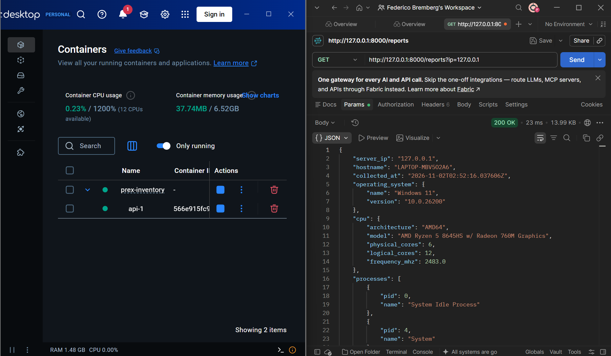

# Prex · Inventario de servidores

Agente de inventario para Windows y Linux y API de recolección desarrollados en Python.
El agente obtiene una instantánea del equipo donde se ejecuta y la envía a la API.
La API conserva cada recepción en SQLite, genera archivos JSON diarios y permite
consultar los datos por IP. Incluye una interfaz web local para revisar y comparar
relevamientos.

Se utiliza la alternativa de infraestructura **local / Docker** del challenge.

## Requisitos cubiertos

| Requisito | Implementación |
|---|---|
| Información del procesador | Modelo, arquitectura, núcleos físicos y lógicos, frecuencia informada |
| Listado de procesos corriendo | PID y nombre de cada proceso visible para el usuario del agente |
| Usuarios con una sesión abierta | Usuario, terminal y fecha de inicio de cada sesión informada por el sistema |
| Nombre del sistema operativo | Campo `operating_system.name` |
| Versión del sistema operativo | Campo `operating_system.version`, separado del nombre |
| Envío del agente a una API | Un `POST /reports` por ejecución |
| Archivo de texto plano JSON | `<IPv4>_<AAAA-MM-DD>.json`, con fecha de recepción UTC |
| Consulta por IP | `GET /reports?ip=<IPv4>` devuelve el último inventario recibido |
| Ejecución en Windows y Linux | Agente y API en Python; instrucciones para ambos sistemas |
| Docker y base normalizada | API en contenedor y SQLite con tablas relacionadas |
| Evidencia de la API disponible | Captura de Docker y consulta exitosa en Postman, incluida más abajo |

## Arquitectura

```text
Equipo Windows/Linux
  └─ agente ── POST /reports ── API FastAPI ── SQLite: cada recepción
                                        └── JSON: último envío de cada día
Navegador / Postman / curl ── GET ────────┘
```

El agente se ejecuta en el host que se quiere relevar. La API puede ejecutarse en
Docker o como proceso Python. Un agente dentro de un contenedor observaría ese
entorno; por eso los comandos de recolección se ejecutan fuera de Docker.

## Instalación y ejecución

Requisitos: **Python 3.11 o posterior** y, para la opción en contenedor, **Docker
Desktop con contenedores Linux** o **Docker Engine con Compose**. Las dependencias
de ejecución y sus versiones están en `requirements.txt`: FastAPI, Uvicorn,
Pydantic, psutil, HTTPX y sus dependencias transitivas.

Todos los comandos se ejecutan desde la raíz de este repositorio.

### 1. Preparar el agente

Windows, en PowerShell:

```powershell
python -m venv .venv
.\.venv\Scripts\python.exe -m pip install -r requirements.txt
```

Linux, en Bash:

```bash
python3 -m venv .venv
.venv/bin/python -m pip install -r requirements.txt
```

La distribución Linux debe tener disponible el módulo `venv`. El agente no necesita
ejecutarse como administrador; informa los datos que su usuario puede consultar.

### 2. Iniciar la API en Docker

```text
docker compose up --build -d
docker compose ps
```

Esperar a que el servicio `api` aparezca como `healthy`.

- Interfaz: <http://127.0.0.1:8000/>
- Documentación HTTP y esquemas: <http://127.0.0.1:8000/docs>
- Disponibilidad: <http://127.0.0.1:8000/health>

La aplicación local no requiere clave de acceso. Compose publica el puerto únicamente
en `127.0.0.1`; dentro del contenedor la API escucha en `0.0.0.0`. El proceso usa un
usuario sin privilegios y guarda los datos en el volumen `inventory-data` del proyecto
Compose. El puerto 8000 debe estar disponible antes de iniciar el servicio.

### 3. Recolectar y enviar

Windows:

```powershell
.\.venv\Scripts\python.exe -m agent --ip 127.0.0.1
```

Linux:

```bash
.venv/bin/python -m agent --ip 127.0.0.1
```

El agente recolecta, envía el inventario y termina. Informa el resultado por consola
y devuelve un código distinto de cero si falla. La opción `--ip` identifica al
equipo observado: no ordena conectarse a otro equipo para recolectar información.
En una demostración con varios equipos, asignar una IPv4 diferente a cada uno.

`--api-url` permite indicar la URL base de la API; su valor predeterminado es
`http://127.0.0.1:8000`. Se admite HTTP en loopback. Un destino remoto requiere HTTPS
y un despliegue con controles de acceso; esta configuración se entrega para uso local.

### 4. Consultar por IP

Windows:

```powershell
Invoke-RestMethod 'http://127.0.0.1:8000/reports?ip=127.0.0.1' | ConvertTo-Json -Depth 10
```

Linux:

```bash
curl --fail --silent --show-error 'http://127.0.0.1:8000/reports?ip=127.0.0.1'
```

En Postman, usar **GET**, la misma URL, **No Auth**, sin cuerpo, y pulsar **Send**.
La respuesta es `200 OK` con los cinco grupos de información. Antes del primer envío
para una IP, la API devuelve `404`.

Consultar hace un GET de datos guardados. Para obtener datos nuevos, volver a ejecutar
el agente; cada ejecución completa realiza un POST.

### Alternativa sin Docker

Después de instalar las dependencias, iniciar la API y dejar la terminal abierta:

```powershell
# Windows
.\.venv\Scripts\python.exe -m api
```

```bash
# Linux
.venv/bin/python -m api
```

La API escucha en `127.0.0.1:8000` y guarda los archivos en `data/`. Ejecutar el agente
desde otra terminal. Usar una sola opción de API a la vez para evitar ocupar el mismo puerto.

| Variable de entorno | Uso |
|---|---|
| `INVENTORY_DATA_DIR` | Directorio de almacenamiento; `data` por defecto, `/app/data` en Docker |
| `INVENTORY_BIND_HOST` | Dirección de escucha; `127.0.0.1` por defecto |

### Ejecución periódica opcional

El mismo comando manual puede programarse con las herramientas del sistema operativo.
En el Programador de tareas de Windows, usar la ruta absoluta de
`.venv\Scripts\python.exe` como programa, `-m agent --ip 127.0.0.1` como argumentos
y la raíz del repositorio como **Iniciar en**. Configurar la repetición deseada,
por ejemplo cada hora, y evitar iniciar otra instancia si la anterior sigue ejecutándose.

En Linux, una entrada horaria en el crontab del usuario puede ejecutar:

```cron
0 * * * * cd /ruta/prex-server-inventory && .venv/bin/python -m agent --ip 127.0.0.1
```

Sustituir la ruta por la ubicación real. La API debe estar disponible y la tarea debe
ejecutarse con el usuario que puede consultar las sesiones. Los fallos de envío se
informan; no se reintenta automáticamente el mismo inventario.

## Interfaz V1 y V2

**V1 · Challenge** muestra los cinco apartados solicitados, consulta el último envío
por IP y permite descargar su JSON. Procesos y sesiones son listados completos, con
desplazamiento vertical. Nombre y versión del sistema operativo aparecen separados.

**V2 · Ampliada** agrega:

- Dashboard de equipos conocidos, última recepción, avisos y distribución por SO.
- Histórico por IP, filtro de recepción por día UTC y páginas de 25 resultados.
- Comparación de una captura base con otra posterior de la misma IP.
- Diferencias exportables en CSV e informe imprimible para guardar como PDF desde el navegador.

El campo **Tiempo máximo sin recibir un inventario (horas)** clasifica los equipos
según su última recepción. Se aplica al pulsar **Aplicar y actualizar**; no cambia
la frecuencia del agente. El valor inicial es dos horas. Un reporte antiguo indica
falta de datos recientes, no acredita que el equipo esté desconectado.

Para comparar, abrir **Histórico y comparación**, elegir **Base** y **Comparado**, y
pulsar **Comparar selección**. Los procesos se agrupan por nombre y cantidad; las
sesiones, por usuario y terminal. Los informes incluyen IDs, fechas UTC y avisos de
ambas fuentes. La pantalla muestra hasta 100 diferencias y las exportaciones incluyen
todas. No se reconstruye actividad entre capturas ni se diagnostican vulnerabilidades.

Ambas pestañas usan el mismo agente, API y almacenamiento.

## API

| Método y ruta | Resultado |
|---|---|
| `GET /health` | Disponibilidad del proceso |
| `POST /reports` | Recibe un inventario JSON y confirma IP, fecha de recepción y nombre de archivo |
| `GET /reports?ip=<IPv4>` | Último inventario de esa IP |
| `GET /history?ip=<IPv4>&day=AAAA-MM-DD&limit=25&offset=0` | Histórico; `day` es opcional y usa recepción UTC |
| `GET /history/<id>` | Inventario completo de una recepción |
| `GET /dashboard?stale_hours=2&limit=25&offset=0` | Totales y página de equipos conocidos |
| `GET /comparisons?before=<id>&after=<id>&format=json` | Comparación; formatos `json`, `csv` y `html` |

El contrato de `POST /reports` está definido en `shared/models.py` y se puede consultar
en `/docs` o `/openapi.json`. Requiere `Content-Type: application/json`.
Los límites son 4 MiB por petición, 20.000 procesos, 1.000 sesiones y 20 avisos.
Histórico y dashboard admiten hasta 100 filas por página.

Errores: `404` inventario inexistente, `413` cuerpo demasiado grande, `415` contenido
no JSON, `422` datos o parámetros inválidos y `500` fallo de almacenamiento.

## Almacenamiento y operación

SQLite contiene cuatro tablas: `reports`, `processes`, `sessions` y `warnings`.
Las últimas tres referencian el ID del reporte. CPU y SO son atributos de cada
instantánea. Un índice por IP y recepción permite consultar el último reporte y
el histórico; una vista obtiene el último registro por IP para el dashboard.

Cada POST se guarda en una transacción y luego publica el JSON mediante reemplazo
atómico. El archivo diario se llama, por ejemplo, `127.0.0.1_2026-11-02.json`. Dos
envíos de la misma IP en el mismo día generan dos registros en SQLite y un JSON con
el último envío. La fecha del archivo se calcula en UTC desde la recepción en la API.

Si falla la escritura del JSON después del commit, el histórico permanece y la API
devuelve `500`. Al reiniciar, se reconstruyen las copias diarias desde SQLite.
Reenviar puede generar otro registro: no hay deduplicación ni garantía de entrega única.

```text
docker compose exec api ls -l /app/data
docker compose logs --tail 30 api
docker compose restart api
docker compose down
```

`down` conserva el volumen; `down -v` lo elimina con todos sus datos. Para respaldar,
detener la API y copiar el volumen completo. En la ejecución sin Docker, respaldar
`data/`. Los inventarios y bases generados están excluidos de Git.

## Alcance y límites

- Se utiliza IPv4 para conservar el nombre literal del archivo en Windows y Linux.
  La IP es declarada por el operador; no acredita la identidad del equipo.
- Los procesos protegidos pueden tener nombre nulo y los que terminan durante la
  lectura pueden omitirse. Los avisos permiten reconocer estas limitaciones.
- Las sesiones son las informadas por el sistema, no todas las cuentas creadas.
  En Linux dependen también del registro de sesiones disponible, como utmp.
- El nombre de CPU usa el registro de Windows o `/proc/cpuinfo`; se informa el primer
  modelo disponible. La versión interna de Windows puede comenzar con `10.0` en Windows 11.
- La entrega utiliza una instancia API local sin autenticación y SQLite. Un despliegue
  en red requeriría identidad de equipos, acceso autenticado y transporte protegido.
  No se implementan retención automática ni escalabilidad horizontal.
- El histórico conserva lo declarado por el agente. No constituye evidencia inmutable
  ni certifica cumplimiento normativo. El dashboard solo conoce equipos que ya reportaron.

## Evidencia de ejecución

La captura muestra el contenedor de la API en ejecución en Docker Desktop y una consulta
real desde Postman a `GET /reports?ip=127.0.0.1`, con respuesta **200 OK**. En el JSON se
observan datos de Windows, CPU y parte del listado de procesos del equipo relevado.



Para reproducir la prueba, iniciar la API, ejecutar el agente y realizar la consulta
por IP de la sección de ejecución. Dos envíos sucesivos pueden verificarse con
`GET /history?ip=127.0.0.1&limit=2`; el listado de `/app/data` permite comprobar el
archivo JSON diario y la base SQLite.

## Estructura

```text
agent/         Recolección y envío desde el equipo observado
api/           Endpoints, SQLite y publicación de JSON
api/static/    Interfaz web y estilos del informe imprimible
shared/        Contrato de datos y límite del cuerpo HTTP
tests/         Pruebas automatizadas
evidence/      Captura de Docker y Postman
Dockerfile     Imagen de la API
compose.yaml   Servicio local y volumen persistente
```
